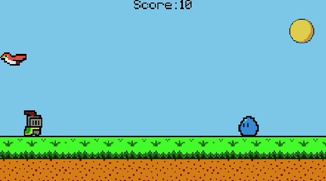

# Knight Runner

A side-scrolling runner game built with **Python, Pygame and NumPy**, inspired by the Google Chrome offline dinosaur game, with custom graphics and an attack mechanic for a high-risk, high-reward playstyle.

Built in 2024 as a team of 2: **Gurshaan Bhullar** and **Aiden**.



## Features
- **Attack mechanic:** press `F` to swing your sword. Hitting a bird or slime inside a strict timing window knocks it away for **+50 bonus points**, with a cooldown so it can't be spammed.
- **3 obstacle types:** birds and slimes (can be attacked) and spikes (can't be attacked, must be jumped).
- **Day/night cycle:** the sky and ground fade smoothly between day and night using NumPy array blending, run on background threads so gameplay never pauses.
- Custom sprite animations (walk, jump, fall, attack), sound effects, background music, and title/game-over screens with your last score.
- Safe asset loading: missing sounds or fonts fall back gracefully instead of crashing.

## Controls
| Key | Action |
|---|---|
| `Space` | Jump / start game |
| `F` | Attack |

## How to run
1. Install Python 3.9+.
2. Install the dependencies:
   ```bash
   pip install -r requirements.txt
   ```
3. Run the game from this folder (the `data/` folder with images, sounds and the font must be next to `main.py`):
   ```bash
   python main.py
   ```

## Project structure
```
knight-runner/
├── main.py           # game code: classes for Ground, Cloud, Player, Attack, Enemy, Spikes + main loop
├── data/             # sprites, sounds, music and Pixeltype font
├── docs/gameplay.gif # gameplay preview
└── requirements.txt
```

## What I learned
- Structuring a game with classes and Pygame's sprite groups
- Game loops, frame timing and custom events (spawning enemies, clouds and the sun/moon)
- Collision detection and timing windows for fair combat
- Using NumPy arrays and threads to animate colour changes without freezing the game
